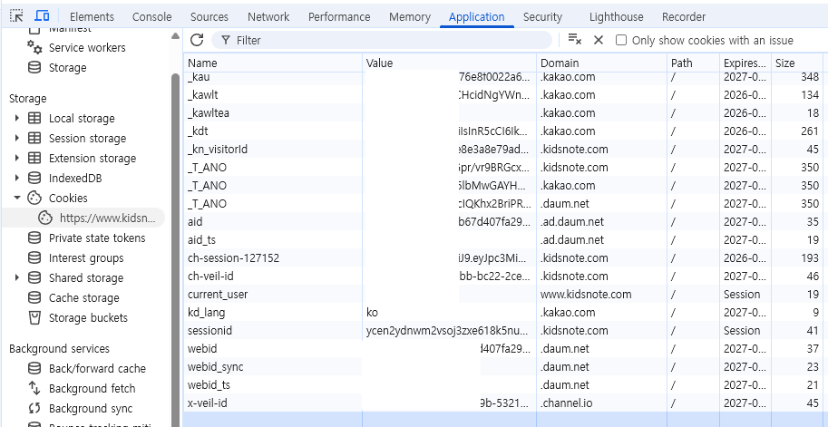

<a id="kidsnote-notion-자동-백업"></a>

# 🍼 Kidsnote → Notion 자동 백업

> **어린이집 알림장과 사진을, 내 노션에 영원히.**
> 졸업할 때 사라지지 않게.

[](LICENSE)
[](#7단계-자동-실행-켜고-백업-시작하기)
[](#이렇게-백업됩니다-실제-결과-스크린샷)

> ⚡ **빨리 셋업만 끝내고 싶다 → [Quick Start (약 20분)](QUICK_START.md)**
> 이 페이지는 자세한 설명·예외처리·문제 해결까지 모두 담은 안내서입니다. 막힘없이 진행하실 분은 위 Quick Start로 가세요.

<a id="이렇게-백업됩니다-실제-결과-스크린샷"></a>

## 📸 이렇게 백업됩니다 (실제 결과 스크린샷)

**알림장 한 건 — AI callout 3개(요약·자녀일기·부모편지) + 날씨 + 원본 본문 + 사진/댓글**

| 본문 + callout (요약·자녀일기·부모편지) | 사진 + 댓글 |
|:---:|:---:|
|  |  |

**자동 생성되는 LLM 대시보드 — 시간순 마일스톤 + 월별 성장 스토리**

| 🌟 우리 아이의 처음들 (마일스톤) | 📖 매월 성장 스토리 |
|:---:|:---:|
|  |  |

**통계 대시보드 — mermaid pie 차트 4종 (영양·카테고리·낮잠·날씨)**

| 🥗 영양 그룹 비율 | 🎨 활동 카테고리 Top 10 |
|:---:|:---:|
|  |  |

| 💤 낮잠 시간 분포 | 🌤️ 날씨 분포 |
|:---:|:---:|
|  |  |

> 💡 위 화면은 실제로 백업된 노션 페이지를 캡처한 것입니다. 본인이 셋업하면 본인 자녀의 알림장으로 똑같이 채워집니다. **셋업은 아래 7단계 가이드대로 약 20분이면 끝납니다.**

---

키즈노트(어린이집 알림장 앱)에 매일 쌓이는 글·사진·동영상·첨부파일을 **나의 노션으로 자동 백업**합니다.

- ✅ **완전 자동** — 6시간마다 새 알림장을 알아서 백업 (한 번 셋업하면 끝)
- ✅ **알림장 원본 그대로** — 본문·사진·동영상·식단·댓글·앨범·공지까지 빠짐없이
- ✅ **통계 대시보드** — 카테고리·낮잠·식사·날씨 분포가 자동으로 정리
- ✅ **준비물·일정 모아보기** — 선생님 글·공지·첨부문서에서 준비물 요청과 날짜가 적힌 일정을 원문 그대로 한 페이지에, 날짜 일정은 노션 달력에도
- ✅ **(선택, off 권장) AI 가공** — 자녀 1인칭 일기·부모 편지 + 매월 성장 스토리/마일스톤/관심사/감사 카드까지 자동 작성. 다만 무료 로컬 LLM 특성상 품질이 완벽하지 않고 1년치에 5-15시간 걸리니, 우선은 `off`로 두고 단순 백업을 권장합니다.
- ✅ 컴퓨터 켜둘 필요 없음 — GitHub의 클라우드 서버가 알아서 실행
- ✅ 자녀가 여러 명이어도 한 번에 — 자녀마다 따로, 동시에 백업
- ✅ 중복 알림장은 자동으로 건너뜀 — 매번 새것만 추가
- ✅ 1년치 대용량 백업도 OK — 한 번에 다 못 끝나도 다음 자동 실행 때 이어서 진행
- ✅ 사진의 위치(GPS) 정보는 업로드 전에 자동 제거
- ✅ **무료** — GitHub와 노션의 무료 플랜으로 충분 (LLM도 무료 Ollama)

> ⚠️ **노션에는 파일당 5MB까지 올라가요**
> - **사진**: 5MB가 넘으면 자동으로 줄여서 올려요
> - **동영상·첨부파일**: 5MB가 넘으면 노션 대신 **키즈노트 원본 링크**를 남겨요. 📊 통계 대시보드 맨 아래에 전부 모아 둬요

---

<a id="목차"></a>

## 📋 목차

- [이런 분께 추천드려요](#이런-분께-추천드려요)
- [🎒 시작 전 준비물](#시작-전-준비물-한눈에-보기)
- [왜 필요한가요](#왜-이-도구가-필요한가요)
- [📸 이렇게 백업됩니다 — 실제 스크린샷](#이렇게-백업됩니다-실제-결과-스크린샷)
- [무엇이 만들어지나요](#무엇이-만들어지나요-자세히)
- [⭐ 시작하기 — 7단계](#시작하기)
  - [0단계. 사전 준비 (계정 + 로그인)](#0단계-사전-준비-계정-로그인)
  - [1단계. GitHub Fork](#1단계-이-프로젝트를-내-github-계정으로-복사하기-fork)
  - [2단계. 노션에 빈 페이지 만들기](#2단계-노션에-빈-페이지-만들기)
  - [3단계. 노션 연결 만들고 토큰 받기](#3단계-노션-연결-만들고-토큰-받기)
  - [4단계. 페이지에 연결 추가 + 링크 복사](#4단계-페이지에-연결-추가하고-링크-복사하기)
  - [5단계. 키즈노트 아이디·비밀번호](#5단계-키즈노트-아이디-비밀번호-확인하기)
  - [6단계. GitHub 시크릿 6개 등록](#6단계-github에-6개-비밀-값-등록하기)
  - [7단계. 자동 실행 켜고 백업 시작](#7단계-자동-실행-켜고-백업-시작하기)
- [(고급) 자녀가 여러 명이거나 AI 가공을 켜고 끄고 싶을 때](#advanced-multichild-and-ai-off)
- [(선택) 노션 페이지 웹 공개](#선택-노션-페이지를-웹에-공개하기)
- [노션 표 보기 추천 (정렬 + 필터 + 리스트 보기)](#노션-db-보기-추천-정렬-설정-리스트-뷰)
- [두 번째 이후 백업 (사용자가 할 일 거의 없음)](#두-번째-이후-백업-거의-안-해도-됨)
- [백업 준비 확인 실패 메일이 왔을 때](#백업-준비-확인-실패-메일이-왔을-때)
- [코드 업데이트가 있을 때 (Sync fork)](#코드-업데이트가-있을-때-내-fork-동기화)
- [자주 묻는 질문](#자주-묻는-질문)
- [문제 해결](#문제-해결-자주-나오는-에러)
- [(부록) 2단계 인증을 켜둔 키즈노트 계정](#부록-2단계-인증을-켜둔-키즈노트-계정)
- [기술 스택 (개발자용)](#기술-스택-개발자용)

---

<a id="이런-분께-추천드려요"></a>

## 이런 분께 추천드려요

✅ **적합**:
- 키즈노트로 매일 자녀 알림장·사진 받는 부모
- 자녀 성장 기록을 **노션에 영구 보관**하고 싶은 분
- 컴퓨터 다루기 어렵진 않지만 **코딩은 모르는** 분 (이 안내만 따라하면 됨)
- 졸업·반편성 때 데이터 사라지는 게 걱정인 분

❌ **안 맞을 수 있어요**:
- 키즈노트가 아닌 다른 어린이집 앱 사용 (예: 알리미24, 호브박스 등)
- 노션 외 다른 저장소(드라이브·드롭박스 등) 원하는 분 → 코드 수정 필요
- 모바일·태블릿만 있는 분 → 셋업은 데스크톱·노트북 필요

---

<a id="시작-전-준비물-한눈에-보기"></a>

## 🎒 시작 전 준비물 (한눈에 보기)

<a id="1-가지고-있어야-하는-것"></a>

### 1. 가지고 있어야 하는 것

| 항목 | 필요한 이유 | 비용 |
|------|------------|-----|
| **데스크톱 또는 노트북** | 셋업이 모두 브라우저에서 진행됨 | - |
| **인터넷 연결** | GitHub·노션 페이지 클릭 | - |
| **이메일 주소** | GitHub·노션 가입 + 실패 알림 받기 | - |

<a id="2-만들어야-하는-계정-3개-0단계에서-진행"></a>

### 2. 만들어야 하는 계정 3개 (0단계에서 진행)

| 계정 | URL | 가입 비용 |
|------|-----|----------|
| **키즈노트** | 어린이집에서 이미 등록한 그 계정 (브라우저 로그인 가능해야 함) | 무료 |
| **노션** | https://www.notion.so | **무료** (Free 플랜으로 충분) |
| **GitHub** | https://github.com/signup | **무료** (Free 플랜) |

<a id="3-비용-정말-0원-입니다"></a>

### 3. 비용 — **정말 0원**입니다

| 사용 자원 | 무료 한도 |
|-----------|----------|
| **GitHub Actions** (자동 실행 서버) | 공개 저장소는 **무제한 무료** — 이 도구는 공개 저장소에서 돌아갑니다 |
| **노션 Free 플랜** | 파일당 5MB (사진은 자동 압축) |
| **Ollama LLM** (AI 가공, 선택) | GitHub 서버 안에서 무료 실행, 외부 API 비용 0원 |

<a id="4-시간-셋업-25분-백업은-자동"></a>

### 4. 시간 — 셋업 약 20분 / 백업은 자동

- **사용자가 직접 손대는 시간**: 셋업 약 20분 (이후 할 일 없음)
- **백그라운드에서 자동으로 도는 시간**: 첫 백업 1-15시간 (AI off/on에 따라) + 이후 6시간마다 새 알림장만 확인

준비 끝났으면 아래로 ⬇️ 시작!

---

<a id="왜-이-도구가-필요한가요"></a>

## 왜 이 도구가 필요한가요

키즈노트는 **졸업하면 접근이 끊깁니다**. 우리 아이의 매일이 담긴 사진과 선생님의 글이, 어느 날 갑자기 사라집니다.

내 노션 워크스페이스에 백업해두면:

- 🔍 **검색됩니다** — "토끼 점토놀이"로 검색해서 그날의 알림장을 1초 만에
- 📅 **정리됩니다** — 날짜순 자동 정렬, 1년치 모아보기
- 🔒 **영원합니다** — 키즈노트가 사라지든 졸업하든 그대로 내 것
- 📸 **사진 원본 보존** — Kakao CDN에서 받은 원본 화질 그대로

---

<a id="무엇이-만들어지나요-자세히"></a>

## 무엇이 만들어지나요

각 알림장은 **노션 페이지 한 장**으로 백업됩니다 — 원본 본문 + 사진(원본 화질·GPS 자동 제거) + 식단 사진 + 댓글 + 날씨. AI를 켜면 자녀 1인칭 일기·부모 편지도 함께 (셋업 6단계에서 선택).

<a id="자동-생성되는-최대-6개-대시보드-싱글톤-페이지"></a>

### 자동 생성되는 최대 7개 대시보드

알림장과 함께, 데이터를 가공한 **고정 페이지(최대 7개)** 가 자동으로 만들어지고 매 실행마다 최신화됩니다. 어떤 어린이집/학원은 식단 정보가 없거나 AI를 꺼두면 일부 페이지가 생성되지 않을 수 있어요:

| 페이지 | 내용 |
|--------|------|
| 📊 **통계 대시보드** | 누계 카테고리·월별·작성자·낮잠·식사·날씨 분포 + **연도별 상세** (각 연도의 알림장 수, 카테고리·월별 분포 등) + 노션에 못 올린 5MB 넘는 파일의 원본 링크 목록 |
| 📋 **준비물·일정** | 선생님·원이 쓴 글·댓글·첨부문서에서 **준비물·요청 문장**(최근 30일)과 **날짜가 적힌 일정**(오늘부터 60일)을 원문 그대로 모아, 원래 글 링크와 함께 표시 |
| 🥗 **영양 분석** | 식단 메뉴 텍스트를 7개 영양 그룹으로 분류해서 등장 빈도 표시 |
| 📖 **매월 성장 스토리** | 월별 알림장을 LLM이 한 단락의 성장 스토리로 작성 — **최근 월이 위, 알림장 없는 달은 빈칸 표시** |
| 🌟 **우리 아이의 처음들 (마일스톤)** | 알림장에서 추출한 발달 단서들 (`벽 짚고 서기`, `동물 이름 말함` 등) **최근→과거** 시간순 |
| 🌱 **분기별 관심사** | 분기별 자녀가 가장 좋아한 활동·사물·사람 TOP 5 — **최근 분기가 위, 빈 분기는 빈칸 표시** |
| 💌 **연도별 선생님께** | 매 연도 알림장 기반으로 **연도마다 별도 감사 편지** 작성 (졸업·연말에 가족이 다듬어 사용) |

**페이지 생성 조건**:

- 📊 통계 — 알림장 1개 이상이면 항상 생성
- 📋 준비물·일정 — 항상 생성 (찾은 게 없으면 "없어요"라고 표시)
- 📅 키즈노트 일정 — 백업 표가 들어 있는 노션 페이지에 **달력**이 하나 더 생기고, 📋에 나온 날짜 일정이 계속 쌓여요. 지난 일정도 남아요. 직접 만든 보기나 열, 바꾼 이름은 그대로 유지돼요 (달력에서 지운 일정은 원래 글에 날짜가 남아 있는 동안 다시 생겨요)
- 🥗 영양 분석 — 식단 정보가 있는 알림장이 1개 이상일 때만 (어학원 등 식단을 안 올리는 곳은 생성 안 됨)
- 📖 / 🌟 / 🌱 / 💌 — AI를 켰을 때만 생성 (셋업 6단계에서 결정)

> 💡 모든 LLM 호출은 **GitHub 서버 안의 무료 Ollama**(`llama3.1:8b`)로 처리되어 외부 API 비용·노출이 없습니다.

---

<a id="시작하기"></a>

# 🚀 시작하기

> ⚠️ **데스크톱 또는 노트북에서 진행하세요**. 모바일/태블릿에서는 GitHub·노션 설정 화면을 찾기 어렵습니다. 휴대폰으로 이 안내를 읽으면서 노트북으로 작업하는 게 가장 편합니다.

<a id="두-가지-시간"></a>

### 두 가지 시간

| 단계 | 사용자가 직접 클릭하는 시간 | 백그라운드에서 알아서 도는 시간 |
|------|------|------|
| **0-7단계 셋업** | **약 20분** ← 여기만 손이 감 | - |
| **첫 전체 백업 (1년치)** | 0분 (그냥 두면 됨) | **AI off: 1-3시간 / AI on: 5-15시간** (자동으로 이어서 진행) |
| **이후 운영** | 0분 | 6시간마다 새 알림장 자동 확인 |

> 💡 **솔직히 말씀드리면**: 안내를 한 번 정독하고 시작하면 셋업 약 20분, 그 다음 점심 먹고 자고 하면 다음날 아침에는 1년치가 다 백업돼 있어요. 사용자가 옆에 붙어있을 일은 거의 없습니다.

<a id="0단계-사전-준비-계정-로그인"></a>

## 0단계. 사전 준비 (계정 + 로그인)

> 🕐 **약 5분** (이미 가입한 분은 1분 안에 끝남)
>
> 📍 **시작 전 확인**: 데스크톱/노트북 + 인터넷 연결

> 👨‍👩‍👧‍👦 **자녀가 2명 이상인가요?** 아래 1-7단계를 **자녀 1명 기준**으로 먼저 끝내세요. 그 다음 [A. 자녀가 여러 명일 때](#a-자녀가-여러-명일-때)에서 노션 페이지 하나와 시크릿 2개만 더 추가하면 됩니다. Fork는 하나로 충분합니다.

<a id="0-1-세-가지-계정이-모두-있어야-합니다"></a>

### 0-1. 세 가지 계정이 모두 있어야 합니다

- [ ] **키즈노트 계정** — 어린이집 등록할 때 받은 계정. 평소 앱으로 쓰는 그 계정
- [ ] **노션 계정** — 없으면 https://www.notion.so 에서 이메일로 가입 (1분)
- [ ] **GitHub 계정** — 없으면 https://github.com/signup 에서 가입 (이메일 인증만 하면 됨, 1분)

<a id="0-2-세-사이트-모두-데스크톱-브라우저에서-한-번씩-로그인-확인"></a>

### 0-2. 세 사이트 모두 데스크톱 브라우저에서 한 번씩 로그인 확인

브라우저 탭 3개 열어서 로그인 상태 확인:

| 사이트 | URL | 확인할 것 |
|---|---|---|
| 키즈노트 | https://www.kidsnote.com | 아이디·비밀번호로 로그인 후 내 자녀 알림장이 보여야 함 |
| 노션 | https://www.notion.so | 로그인 후 왼쪽에 사이드바가 있는 노션 화면이 보여야 함 |
| GitHub | https://github.com | 로그인 후 우측 상단에 내 프로필 사진이 보여야 함 |

<a id="0-3-노션-처음-사용자만-워크스페이스-만들기"></a>

### 0-3. 노션 처음 사용자만 — 워크스페이스 만들기

"워크스페이스" = 내 노션 페이지들이 모여 있는 공간입니다. 노션 가입 직후라면 만드는 안내가 자동으로 뜹니다:

1. 용도를 물으면 **개인용**에 해당하는 항목 선택
2. 워크스페이스 이름은 자유 (예: "내 노션")
3. 권유하는 템플릿이나 초대 화면은 모두 **건너뛰기 / Skip**
4. 빈 화면 또는 시작 페이지가 나오면 OK

✅ **0단계 성공 신호**: 데스크톱 브라우저에서 키즈노트·노션·GitHub 모두 로그인됨, 노션은 본인 워크스페이스 화면이 보임.

> 💡 **이 안내를 휴대폰으로 보고 있다면**: 휴대폰은 읽기용으로 두고, 노트북에서 위 세 사이트에 로그인해 두세요. 다음 단계부터 모두 노트북에서 진행합니다.

---

<a id="1단계-이-프로젝트를-내-github-계정으로-복사하기-fork"></a>

## 1단계. 이 프로젝트를 내 GitHub 계정으로 복사하기 (Fork)

> 🕐 **약 1분**
>
> 📍 **시작 전 확인**: GitHub 로그인 완료 (0단계)

**Fork(포크)** = 이 프로젝트를 내 GitHub 계정으로 복사하는 것. 원본은 그대로 두고, 내 사본에서 설정합니다.

1. GitHub에서 **이 페이지** ([https://github.com/redchupa/kidsnote-backup](https://github.com/redchupa/kidsnote-backup)) 를 엽니다 (이미 보고 있다면 그대로)
2. 페이지 **우측 상단**, 별 모양 **`Star`** 버튼 옆의 **`Fork`** 버튼 클릭
3. "새 fork 만들기" 화면이 나옴 → 입력칸은 모두 그대로 두고 아래쪽 녹색 **`Create fork`** 버튼 클릭
4. 잠시 후 자동으로 **본인 계정의 사본 페이지**로 이동됨

✅ **1단계 성공 신호**: 페이지 좌측 상단의 경로 표시가 `내깃허브아이디 / kidsnote-backup` (원본은 `redchupa / kidsnote-backup`이었음).

> 🔒 내 사본(fork)은 GitHub 규칙상 **공개 상태**입니다. 공개되는 건 코드뿐이고, 비밀번호·토큰은 [6단계](#6-3-시크릿-6개-등록)에서 암호화된 시크릿으로 따로 저장되어 누구에게도 보이지 않습니다.

<a id="막혔다면-1단계"></a>

### ❓ 막혔다면

| 증상 | 원인 / 해결 |
|---|---|
| Fork 버튼이 안 보임 | GitHub에 로그인하지 않은 상태. 우측 상단 `Sign in` 클릭 후 로그인 |
| 이미 fork가 있다는 안내가 나옴 | 이전에 fork한 적 있음. 우측 상단 프로필 사진 → `Your repositories` → `kidsnote-backup` 들어가서 그대로 사용 |
| 자녀별로 fork를 하나 더 만들고 싶음 | 필요 없습니다 (같은 계정에 같은 프로젝트를 두 번 fork할 수도 없음). 한 fork에서 자녀 여럿을 백업합니다 → [A. 자녀가 여러 명일 때](#a-자녀가-여러-명일-때) |
| 화면이 멈춘 것 같음 | 새로고침 후 다시 시도 |

> 💡 **fork 주소를 즐겨찾기에 추가하세요**: 나중에 돌아올 때 필요합니다. 형태: `https://github.com/내깃허브아이디/kidsnote-backup`

---

<a id="2단계-노션에-빈-페이지-만들기"></a>

## 2단계. 노션에 빈 페이지 만들기

> 🕐 **약 1분**
>
> 📍 **시작 전 확인**: 노션 로그인 + 워크스페이스 화면이 보임 (0단계)

백업이 들어갈 **빈 페이지** 하나만 만들면 됩니다. 표(데이터베이스)는 첫 백업 때 이 페이지 안에 자동으로 만들어집니다.

> 💡 노션은 화면이 자주 바뀝니다. 아래 2-4단계의 버튼 이름이 조금 다르면 비슷한 이름을 찾아 누르세요.

1. 노션 **좌측 사이드바 맨 위**의 **📝** (새 페이지) 버튼 클릭
   - 또는 사이드바의 **`개인 페이지`** (영문: `Private`) 글자에 마우스를 올리면 옆에 나타나는 **`+`** 클릭
   - 사이드바가 안 보이면: 화면 좌측 상단의 `≡` 아이콘을 눌러 펼치기
2. 새 페이지가 열리면 맨 위 큰 글씨 제목 칸에 **`키즈노트 백업`** 입력 (이름은 자유)
3. 본문은 **비워둔 채** 그대로 둡니다

✅ **2단계 성공 신호**: 좌측 사이드바에 **`키즈노트 백업`** 페이지가 보이고, 그 페이지가 열려 있음.

---

<a id="3단계-노션-연결-만들고-토큰-받기"></a>

## 3단계. 노션 연결 만들고 토큰 받기

> 🕐 **약 3분**
>
> 📍 **시작 전 확인**: 노션 로그인 유지 중

**연결(Connection)** = 이 도구가 내 노션 페이지에 글을 쓸 수 있게 해 주는 출입증입니다 (예전 이름: 통합/Integration). **토큰** = 그 출입증의 비밀번호입니다.

1. **새 탭**에서 https://app.notion.com/developers/connections 접속
   - 로그인 화면이 나오면 노션에 로그인한 뒤 다시 이 주소로 접속
   - 이 화면은 영어로 나올 수 있습니다. 아래에 영어 이름을 함께 적었어요
2. **`Create a new connection`** 버튼 클릭 (`Build` → `Internal connections` 아래에 있음)
3. 입력 화면에서:
   - **Name**(이름): `kidsnote-backup` 입력 (자유)
   - **Workspace**(워크스페이스): 2단계 페이지를 만든 본인 워크스페이스 선택
4. **`Save`** (저장) 클릭
5. 만든 연결 화면에서 **`Configuration`** (구성) 탭을 엽니다
6. 같은 탭에서 콘텐츠 권한 **읽기(Read content) · 업데이트(Update content) · 입력(Insert content)** 세 개가 **모두 체크**돼 있는지 확인 (꺼져 있으면 체크)
7. **`Installation access token`** 항목의 토큰을 **복사** (보기/Show를 눌러야 보이면 먼저 누르기)

⚠️ 복사한 토큰을 **메모장에 잠깐 붙여두세요**. 6단계에서 GitHub에 등록합니다.

> 💡 개발자 화면이 열리지 않으면 다른 길도 있습니다: 노션 왼쪽 사이드바 **`설정`** (Settings) → **`연결`** (Connections) → **`+ 새 연결`** (New connection).

토큰 모양: `ntn_`으로 시작하는 긴 영문+숫자 (예전에 만든 토큰은 `secret_`으로 시작)

✅ **3단계 성공 신호**: 메모장에 `ntn_` 또는 `secret_` 으로 시작하는 긴 영문+숫자 문자열이 있음.

<a id="막혔다면-3단계"></a>

### ❓ 막혔다면

| 증상 | 원인 / 해결 |
|---|---|
| `Create a new connection` 버튼이 없음 | 연결은 워크스페이스 소유자만 만들 수 있습니다. 혼자 만든 개인 워크스페이스라면 자동으로 소유자예요. 회사·학교 워크스페이스라면 0-3처럼 개인 워크스페이스를 따로 만들어 거기서 진행 |
| 워크스페이스 선택지가 없음 | 0-3 워크스페이스 만들기를 빠뜨림. 노션 메인 화면에서 워크스페이스부터 만들기 |
| 토큰 복사 전에 창을 닫음 | https://app.notion.com/developers/connections 에서 만든 연결을 클릭 → `Configuration` 탭에서 다시 복사 |

> 🔒 **이 토큰은 다른 사람에게 절대 공유하지 마세요**. 토큰만 있으면 연결된 노션 페이지에 글을 쓸 수 있습니다.

---

<a id="4단계-페이지에-연결-추가하고-링크-복사하기"></a>

## 4단계. 페이지에 연결 추가하고 링크 복사하기

> 🕐 **약 2분**
>
> 📍 **시작 전 확인**: 2단계 `키즈노트 백업` 페이지가 있음 + 3단계 연결 저장 완료

연결을 만들었어도, **어느 페이지에 쓸지** 직접 허락해 줘야 합니다.

<a id="4-1-페이지에-연결-추가하기"></a>

### 4-1. 페이지에 연결 추가하기

1. 노션 좌측 사이드바에서 **`키즈노트 백업`** 페이지 클릭해서 열기
2. 페이지 **우측 상단**의 **`•••`** (점 세 개) 클릭
3. 메뉴에서 **`연결`** (영문: `Connections`) 찾기 → **`+ 연결 추가`** (영문: `Add connection`) 클릭
4. 검색칸에 **`kidsnote-backup`** (3단계에서 지은 이름) 입력 → 나타난 항목 클릭
5. 접근을 허용할지 묻는 창이 뜨면 **확인/허용** 버튼 클릭

✅ **4-1 성공 신호**: 다시 `•••` → `연결`을 보면 **`kidsnote-backup`** 이 목록에 보임.

> 💡 다른 방법: https://app.notion.com/developers/connections → 만든 연결 클릭 → **`Content access`** (콘텐츠 접근) 탭 → 접근 편집 → `키즈노트 백업` 페이지 선택.

<a id="4-2-페이지-링크-복사하기"></a>

### 4-2. 페이지 링크 복사하기

1. 같은 페이지 **우측 상단**의 **`공유`** (영문: `Share`) 클릭
2. **`링크 복사`** (영문: `Copy link`) 클릭
   - 또는 브라우저 주소창의 주소를 통째로 복사해도 됩니다
3. 메모장에 붙여넣기

링크는 `https://www.notion.so/...` 또는 `https://app.notion.com/...` 로 시작합니다. **어느 쪽이든 그대로** 쓰면 되고, 주소 안에서 무언가를 골라낼 필요도 없습니다.

✅ **4단계 성공 신호**: 메모장에 **토큰**(3단계)과 **페이지 링크**(4단계) 두 개가 있음.

<a id="막혔다면-4단계"></a>

### ❓ 막혔다면

| 증상 | 원인 / 해결 |
|---|---|
| 검색해도 `kidsnote-backup`이 안 나옴 | 3단계에서 다른 워크스페이스를 골랐을 가능성. 3단계 연결 화면에서 워크스페이스 확인 |
| `•••` 메뉴에 `연결`이 안 보임 | 메뉴를 아래로 스크롤. 그래도 없으면 위 "다른 방법"(`Content access` 탭)으로 연결 |
| 표(데이터베이스)가 안 보여요 | 정상입니다. 표는 첫 백업 때 이 페이지 안에 자동으로 만들어집니다 |

---

<a id="5단계-키즈노트-아이디-비밀번호-확인하기"></a>

## 5단계. 키즈노트 아이디·비밀번호 확인하기

> 🕐 **약 1분**
>
> 📍 **시작 전 확인**: 키즈노트 웹 로그인 확인 완료 (0단계)

**따로 할 일은 없습니다.** https://www.kidsnote.com 에 로그인할 때 쓰는 **아이디와 비밀번호**를 6단계에서 그대로 입력합니다.

> 💡 비밀번호가 기억나지 않으면 키즈노트에서 비밀번호를 재설정한 뒤 새 비밀번호를 쓰세요.

✅ **5단계 성공 신호**: https://www.kidsnote.com 에서 그 아이디·비밀번호로 로그인이 됨.

---

<a id="6단계-github에-6개-비밀-값-등록하기"></a>

## 6단계. GitHub에 6개 비밀 값 등록하기

> 🕐 **약 5분**
>
> 📍 **시작 전 확인**: 메모장에 노션 토큰(3단계)과 페이지 링크(4단계)가 있고, 키즈노트 아이디·비밀번호를 알고 있음

**시크릿(Secret)** = GitHub에 암호화해서 보관하는 비밀 값입니다. 모은 값을 내 fork에 저장합니다.

<a id="6-1-내-fork-페이지-settings로-이동"></a>

### 6-1. 내 fork 페이지 → Settings로 이동

1. 1단계에서 만든 **내 fork** 페이지로 이동:
   - 주소 직접 입력: `https://github.com/내깃허브아이디/kidsnote-backup`
   - 또는 GitHub 우측 상단 프로필 사진 클릭 → **`Your repositories`** → **`kidsnote-backup`** 클릭
2. 페이지 위쪽 **메뉴 줄**(`Code`, `Issues`, `Pull requests`, `Actions` ...)의 오른쪽 끝 **`Settings`** 클릭
   - ⚠️ 우측 상단 프로필 사진 메뉴 안의 `Settings`는 **GitHub 계정 설정**입니다. 여기서는 **메뉴 줄의 Settings**를 누르세요

<a id="6-2-secrets-페이지로"></a>

### 6-2. Secrets 페이지로

3. 왼쪽 사이드바의 **`Security`** 묶음에서 **`Secrets and variables`** 클릭 (펼쳐짐) → 아래에 나타난 **`Actions`** 클릭
4. 화면 오른쪽의 녹색 **`New repository secret`** 버튼 클릭

<a id="6-3-시크릿-6개-등록"></a>

### 6-3. 시크릿 6개 등록

다음 표대로 **6번 반복**해서 등록합니다 — 한 번에 하나씩.

| Name (정확히 일치, 대소문자 구분) | Secret 값 |
|---|---|
| `NOTION_TOKEN` | 3단계에서 복사한 토큰 (`ntn_...` 또는 `secret_...`) |
| `NOTION_DATABASE_ID` | 4단계에서 복사한 **페이지 링크를 통째로** 붙여넣기 |
| `KIDSNOTE_USERNAME` | 키즈노트에 로그인할 때 쓰는 **아이디** |
| `KIDSNOTE_PASSWORD` | 키즈노트 **비밀번호** |
| `KIDSNOTE_CHILD_NAME` | 백업할 자녀 이름. 일부만 적어도 됩니다 — 자녀 이름이 `우하린`이면 `우하린`/`하린` 모두 OK. **자녀가 1명이어도 꼭 등록** |
| `AI_FEATURES` | **`off` 권장** (AI 가공 끄기, 1년치 1-3시간). `on`으로 켜면 자녀 일기/부모 편지/LLM 대시보드 4종이 추가되지만 무료 로컬 LLM 품질이 완벽하지 않고 1년치 5-15시간 소요 |

> 🔒 **비밀번호도 안전합니다**: 시크릿은 암호화되어 저장되고, 등록 후에는 본인도 값을 다시 볼 수 없으며, 실행 로그에 나오지 않고, fork한 사람을 포함해 다른 누구에게도 보이지 않습니다.

**한 시크릿씩 등록하는 방법**:
1. `New repository secret` 버튼 클릭
2. **`Name`** 칸에 시크릿 이름 입력 (위 표 그대로)
3. **`Secret`** 칸에 값 붙여넣기
4. 녹색 **`Add secret`** 버튼 클릭 → 시크릿 목록 화면으로 돌아감
5. 다음 시크릿은 다시 `New repository secret` 클릭 → 반복

> ⚠️ **이름 오타가 가장 흔한 실수**: `NOTION-TOKEN`, `Notion_Token`, `NOTIONTOKEN` 등은 인식되지 않습니다. **반드시 표와 똑같이 대문자 + 언더바(`_`)**. 복사해서 붙여넣으면 가장 안전합니다.
>
> 💡 **값**은 대충 붙여넣어도 괜찮습니다. 앞뒤 공백·줄바꿈·따옴표·보이지 않는 문자는 자동으로 정리되고, `on`/`off`도 대소문자와 상관없이 인식됩니다.

✅ **6단계 성공 신호**: 시크릿 목록(Repository secrets)에 다음 6개가 정확한 이름으로 보임:
```
AI_FEATURES
KIDSNOTE_CHILD_NAME
KIDSNOTE_PASSWORD
KIDSNOTE_USERNAME
NOTION_DATABASE_ID
NOTION_TOKEN
```
값은 보이지 않고 이름과 수정 시간만 보임 = 정상.

<a id="시크릿-고치는-법"></a>

### ✏️ 시크릿 고치는 법

- **값이 틀렸을 때**: 시크릿 목록에서 그 시크릿 옆 **연필 아이콘** 클릭 → 새 값 입력 → **`Update secret`**
- **이름이 틀렸을 때**: 이름은 수정할 수 없습니다. 옆의 **휴지통 아이콘**으로 삭제한 뒤 `New repository secret`으로 올바른 이름을 다시 추가하세요

<a id="막혔다면-6단계"></a>

### ❓ 막혔다면

| 증상 | 원인 / 해결 |
|---|---|
| `Settings` 탭이 안 보임 | 원본(`redchupa/kidsnote-backup`)을 보고 있을 가능성. 1단계에서 만든 본인 fork 주소로 이동 |
| `Secrets and variables` 메뉴 없음 | 왼쪽 사이드바를 아래로 스크롤. **`Security`** 묶음 안에 있음 |
| 이름을 잘못 입력함 | 위 [시크릿 고치는 법](#시크릿-고치는-법)대로 삭제 후 다시 추가 |
| 시크릿이 7개 이상 있음 | 이전에 다른 시크릿을 만든 적 있음. 위 6개만 정확하면 나머지는 그대로 둬도 됨 |

---

<a id="7단계-자동-실행-켜고-백업-시작하기"></a>

## 7단계. 자동 실행 켜고 백업 시작하기

> 🕐 **클릭은 약 3분**, 백업 자체는 5분에서 15시간 (알림장 개수 + AI 설정에 따라)
>
> 📍 **시작 전 확인**: 시크릿 6개 등록 완료 (6단계) + 노션 페이지에 연결 추가 완료 (4단계)

**Actions** = GitHub가 내 대신 백업 프로그램을 돌려주는 기능입니다. **워크플로(workflow)** = 그 백업 작업의 이름입니다.

<a id="7-1-actions-켜기-처음-한-번만"></a>

### 7-1. Actions 켜기 (처음 한 번만)

1. 내 fork 페이지 위쪽 메뉴 줄에서 **`Actions`** 탭 클릭
2. 처음이면 "이 fork에서는 워크플로가 실행되지 않고 있다"는 안내가 나옵니다 → 녹색 **`I understand my workflows, go ahead and enable them`** 버튼 클릭
   - 이미 켜져 있으면 이 안내 없이 바로 워크플로 목록이 보입니다

✅ **7-1 성공 신호**: 왼쪽 목록에 **`Kidsnote → Notion mirror`** 가 보임.

> 💡 목록의 **`개발자용 테스트 (사용자는 실행할 필요 없음)`** 는 무시하세요. 항상 **`Kidsnote → Notion mirror`** 를 고르면 됩니다.

<a id="7-2-자동-실행-켜기-처음-한-번만"></a>

### 7-2. 6시간마다 자동 실행 켜기 (처음 한 번만)

fork에서는 **자동 실행이 기본으로 꺼져 있습니다.** 이걸 켜야 6시간마다 알아서 백업됩니다.

3. 왼쪽 목록에서 **`Kidsnote → Notion mirror`** 클릭
4. 오른쪽에 예약(자동) 실행이 꺼져 있다는 안내와 **`Enable workflow`** 버튼이 보이면 → **클릭**
   - 안내가 없으면 이미 켜진 상태이니 그대로 진행

> 💡 아래 7-3의 첫 실행도 자동 실행을 켜 주지만, 위 버튼이 보이면 꼭 눌러 두세요.

<a id="7-3-첫-실행은-3개만-limit-3"></a>

### 7-3. 첫 실행은 3개만 (limit 3)

> 💡 **처음에는 알림장 3개만 백업해서 셋업이 맞는지 확인**하고, 그 다음에 전체 백업을 돌리세요.

5. 같은 화면 오른쪽의 **`Run workflow ▾`** 드롭다운 클릭
6. 작은 입력창이 펼쳐짐:
   - `Use workflow from` (Branch): **`main`** 그대로
   - **`limit`**: **`3`** 입력
   - `monthly_sample`, `force_refresh`, `relabel`: **`off`** 그대로
7. 입력창 아래 녹색 **`Run workflow`** 버튼 클릭

잠시 후 목록 맨 위에 새 실행이 나타납니다 (안 보이면 몇 초 기다리기). 실행 옆 아이콘의 뜻:

| 아이콘 | 뜻 |
|---|---|
| 노란색/갈색 점, 또는 빙글빙글 도는 아이콘 | 대기 중이거나 실행 중 (실패 아님) |
| 녹색 체크 ✅ | 성공 |
| 빨간 X ❌ | 실패 → [문제 해결](#문제-해결-자주-나오는-에러) |

<a id="7-4-결과-확인하기"></a>

### 7-4. 결과 확인하기

**① 첫 확인 단계 (몇 초)**

실행은 항상 **로그인과 설정을 먼저 확인**합니다. 실행을 클릭 → 왼쪽 **`백업 (자녀 1)`** 클릭 → **`Check login and settings`** 줄을 펼치면 결과가 보입니다.

잘 됐다면 이런 줄이 보입니다:
```
키즈노트 로그인 OK (fresh login)
자녀 확인 OK: 우*린
노션 연결 OK (빈 페이지 — 첫 실행 때 그 안에 백업용 데이터베이스를 만듭니다)
```
두 번째 실행부터는 마지막 줄이 `노션 연결 OK (페이지 안의 데이터베이스를 사용합니다)`로 바뀝니다.
> 💡 자녀 이름은 일부가 `*`로 가려져 나옵니다. 공개 저장소의 실행 기록은 누구나 볼 수 있기 때문이에요.

문제가 있으면 실행 화면에 **`백업 준비 확인 실패`** 라는 제목과 한국어 이유, `[invalid_credentials]` 같은 이유 코드가 나옵니다 → [준비 확인 실패 이유별 해결](#준비-확인-실패-이유별-해결)에서 코드를 찾아 고치세요.

**② 노션 확인 (AI off 약 3-5분 / AI on 약 15-25분 후)**

노션의 **`키즈노트 백업`** 페이지를 열면:
- 페이지 안에 **`키즈노트 백업`** 표(데이터베이스)가 자동으로 생겼음
- 알림장 3개가 한 줄씩 들어가 있고, 클릭하면 본문 + 사진이 보임
- 📊 통계 / 📋 준비물·일정 / 🥗 영양(식단 정보가 있을 때) 대시보드 페이지도 생김
- AI를 `on`으로 했다면 각 알림장에 요약·자녀 일기·부모 편지 칸 3개가 추가됨

> ⚠️ **3개만 백업할 때는 AI 대시보드 4개(📖🌟🌱💌)가 만들어지지 않습니다** — 데이터가 부족하기 때문이에요. 7-5 전체 백업에서 채워집니다.

<a id="7-5-전체-백업-실행"></a>

### 7-5. 전체 백업 실행

3개가 정상이면, 7-3과 같은 방법으로 다시 실행하되 이번에는 **`limit` 칸을 비워둡니다** (나머지는 `off` 그대로).

> ⚠️ **첫 백업 시간** — 시크릿 `AI_FEATURES` 설정에 따라 크게 차이납니다.
>
> **AI off** — 사진 업로드 시간이 대부분
>
> | 알림장 수 | 예상 시간 | 실행 횟수 |
> |---|---|---|
> | 50개 미만 | 5-15분 | 1회 |
> | 100-200개 | 30분-1.5시간 | 1회 |
> | 300-400개 + 사진 많음 | **1-3시간** | 1회 |
>
> **AI on** — 알림장마다 AI 글쓰기 3번 + AI 대시보드 4개 작성
>
> | 알림장 수 | 예상 시간 | 실행 횟수 |
> |---|---|---|
> | 50개 미만 (몇 달치) | 1-3시간 | 1회 |
> | 100-200개 (반년) | 3-6시간 | 1-2회 |
> | 300-400개 (1년치) + 사진 많음 | **5-15시간** | **2-3회** |
>
> GitHub는 한 번 실행을 **최대 6시간**까지만 돌려줍니다. 그 안에 못 끝나면 **다음 자동 실행 때 멈춘 곳부터 이어서** 백업하니, 다시 클릭할 필요는 없어요.

<a id="자동-재개-한-번만-트리거하면-알아서-끝납니다"></a>

### 🤖 자동 재개 — 한 번만 실행하면 알아서 끝납니다

`Run workflow` 한 번만 누르면 끝. 이후로는 **6시간마다 자동으로** 멈춘 지점부터 이어서 백업하고, 다 끝나면 그 뒤로는 새 알림장만 1-2분 만에 확인하고 끝납니다.

<a id="7-6-실패-알림-메일-설정-확인-한-번만"></a>

### 7-6. 실패 알림 메일 설정 확인 (한 번만)

문제가 생기면 GitHub가 가입 이메일로 알려 주도록 한 번만 확인하세요:

1. GitHub 우측 상단 **프로필 사진** → **`Settings`** (이번엔 계정 설정)
2. 왼쪽 **`Notifications`** 클릭
3. **`System`** 묶음의 **`Actions`** 항목에서 알림 방식을 **Email**로, 그리고 **"Only notify for failed workflows"**(실패한 워크플로만 알림)를 선택

<a id="진행-상황-보기"></a>

### 진행 상황 보기 (선택)

실행 중인 항목 클릭 → 왼쪽 **`백업 (자녀 1)`** → **`Mirror Kidsnote → Notion`** 줄을 펼치면 로그가 실시간으로 올라옵니다. `12.5% (5/40)` 처럼 진행률이 표시돼요.

<a id="만약-중간에-멈추면"></a>

### 만약 중간에 멈추면?

- **이미 만들어진 노션 페이지는 그대로 유지**됩니다
- 다음 자동 실행(또는 `Run workflow`) 때 **이어서** 백업됩니다. 이미 있는 알림장은 건너뛰니 중복되지 않아요

✅ **7단계 최종 성공 신호**:
- Actions 화면에서 실행 옆 아이콘이 **녹색 체크 ✅**
- 노션 `키즈노트 백업` 표에 알림장들이 들어가 있음
- 알림장을 클릭하면 본문 + 🌤️ 날씨 + 사진 + 첨부파일이 보임 (AI on이면 💭 요약 / 🧒 자녀 일기 / 👨‍👩‍👧 부모 편지도)
- 사진 클릭하면 원본 화질로 열림
- 대시보드 페이지도 보임 — AI off면 📊 통계 + 📋 준비물·일정 + 🥗 영양 3개, AI on이면 📖 성장 스토리 / 🌟 마일스톤 / 🌱 관심사 / 💌 선생님께까지 최대 7개

✅ **이제 끝**: 이 시점부터는 **사용자가 할 일이 없어요**. 6시간마다 새 알림장이 자동으로 백업됩니다.

<a id="막혔다면-7단계"></a>

### ❓ 막혔다면

| 증상 | 원인 / 해결 |
|---|---|
| Actions 탭에 워크플로가 없음 | 7-1의 녹색 `I understand...` 버튼을 안 눌렀을 가능성. 눌렀는데도 없으면 1-2분 후 새로고침 |
| `Run workflow` 버튼이 없음 | 왼쪽 목록에서 `Kidsnote → Notion mirror`를 먼저 클릭했는지 확인. 원본이 아닌 본인 fork인지도 확인 |
| 실행이 노란색/갈색으로 한참 그대로 | 대기 중이거나 실행 중입니다 (실패 아님). 전체 백업은 몇 시간 걸릴 수 있어요 |
| 빨간 X ❌ + `백업 준비 확인 실패` | [준비 확인 실패 이유별 해결](#준비-확인-실패-이유별-해결)에서 `[이유 코드]` 찾기 |
| 녹색 ✅인데 노션에 아무것도 없음 | 실행 화면에 `백업 준비 확인 실패 (이미 알림 보냄)` 경고가 있는지 확인 → 있으면 [준비 확인 실패 이유별 해결](#준비-확인-실패-이유별-해결) |
| 6시간이 지나도 자동 실행이 안 생김 | 7-2의 `Enable workflow` 버튼을 확인 |

---

<a id="advanced-multichild-and-ai-off"></a>

# 👨‍👩‍👧‍👦 (고급) 자녀가 여러 명이거나 AI 가공을 켜고 끄고 싶을 때

기본 셋업은 **자녀 1명** 기준입니다. 아래 두 경우 중 하나라도 해당되면 읽어주세요.

---

<a id="a-자녀가-여러-명일-때"></a>

## A. 자녀가 여러 명일 때 — 한 fork에서 함께 백업

키즈노트 계정에 자녀가 여러 명(쌍둥이·형제·자매)이면, **지금 쓰는 fork 하나**에서 최대 5명까지 백업할 수 있습니다. 새 fork는 만들지 않습니다.

- 키즈노트 아이디·비밀번호, 노션 연결·토큰, `AI_FEATURES`는 **모든 자녀가 함께** 씁니다
- 자녀마다 **노션 페이지 하나**와 **시크릿 2개**만 더 만들면 됩니다

<a id="둘째-자녀-추가하기"></a>

### 📋 둘째 자녀 추가하기 (1-7단계를 첫째 기준으로 끝냈다고 가정)

> 🕐 **약 5분**

1. **노션에 빈 페이지 하나 더 만들기** — [2단계](#2단계-노션에-빈-페이지-만들기)와 같은 방법. 제목은 `키즈노트 백업 - 둘째이름`처럼 구분되게
2. **그 페이지에 같은 연결 추가** — [4-1](#4-1-페이지에-연결-추가하기)과 같은 방법으로 `kidsnote-backup` 연결 추가. 연결과 토큰은 새로 만들 필요 없습니다
3. **그 페이지 링크 복사** — [4-2](#4-2-페이지-링크-복사하기)와 같은 방법
4. **시크릿 2개 추가** — [6단계](#6-3-시크릿-6개-등록)와 같은 방법으로 `New repository secret`:

| Name | Secret 값 |
|---|---|
| `KIDSNOTE_CHILD_NAME_2` | 둘째 이름 (일부만 적어도 됨) |
| `NOTION_DATABASE_ID_2` | 1번에서 만든 둘째용 페이지 링크 (통째로) |

> 💡 (선택) 둘째 페이지에 **일부러 다른 연결**을 쓰고 싶을 때만 `NOTION_TOKEN_2`에 그 연결의 토큰을 추가하세요. 보통은 필요 없습니다.

<a id="셋째-이후"></a>

### 🧒 셋째 이후

같은 방법으로 번호만 바꿔 추가합니다 (다섯째까지):

| 자녀 | 자녀 이름 시크릿 | 노션 페이지 링크 시크릿 |
|---|---|---|
| 첫째 | `KIDSNOTE_CHILD_NAME` | `NOTION_DATABASE_ID` |
| 둘째 | `KIDSNOTE_CHILD_NAME_2` | `NOTION_DATABASE_ID_2` |
| 셋째 | `KIDSNOTE_CHILD_NAME_3` | `NOTION_DATABASE_ID_3` |
| 넷째 | `KIDSNOTE_CHILD_NAME_4` | `NOTION_DATABASE_ID_4` |
| 다섯째 | `KIDSNOTE_CHILD_NAME_5` | `NOTION_DATABASE_ID_5` |

✅ **성공 신호**: 다음 실행(6시간마다 자동, 또는 [7-3](#7-3-첫-실행은-3개만-limit-3)처럼 `Run workflow`) 화면 왼쪽에 **`백업 (자녀 1)`**, **`백업 (자녀 2)`** … 가 나란히 보이고 동시에 진행됩니다. 각 자녀의 `Check login and settings`에 `자녀 확인 OK`가 보이고, 자녀마다 자기 노션 페이지 안에 표가 따로 만들어집니다.

<a id="막혔다면-자녀-여러-명"></a>

### ❓ 막혔다면

| 증상 | 원인 / 해결 |
|---|---|
| `백업 (자녀 2)`가 안 보임 | `NOTION_DATABASE_ID_2` 이름 오타 가능성. [시크릿 고치는 법](#시크릿-고치는-법)대로 삭제 후 다시 추가 |
| `백업 (자녀 2)`에서 `[notion_no_access]` | 둘째 페이지에 연결을 추가하지 않았음 → [4-1](#4-1-페이지에-연결-추가하기) |
| `[child_ambiguous]` | 적은 이름이 자녀 여러 명과 겹침 → 더 긴 이름으로 수정 |
| `[child_name_required]` | 첫째용 `KIDSNOTE_CHILD_NAME`이 비어 있음 → 첫째 이름 등록 |

---

<a id="b-ai-가공을-안-쓰고-단순-백업-통계만-원할-때"></a>

## B. AI 가공 켜기/끄기 + 일부 대시보드만 골라 끄기

> 💡 **`off` 권장**. 무료 로컬 LLM(`llama3.1:8b`)이라 가끔 어색한 표현이 나오고, 1년치 백업이 5-15시간으로 길어집니다. 단순 백업이 더 안정적이고 빠르며, 노션에서 검색·정렬만으로도 충분히 추억 정리가 가능해요. 시험 삼아 한 번 켜보고 싶을 때만 `on`으로 바꾸세요.

AI를 켜면 백업 결과에 두 가지가 추가됩니다:

1. **각 알림장마다** 3개 AI callout (💭 요약 · 🧒 자녀의 일기 · 👨‍👩‍👧 부모의 편지)
2. **별도 페이지로** 4개 AI 대시보드 (📖 매월 성장 스토리 · 🌟 마일스톤 · 🌱 분기 관심사 · 💌 연도별 선생님께)

<a id="ai-한-방-스위치-aifeatures"></a>

### 🎚️ AI 전체 켜기/끄기

셋업 6단계에서 등록한 `AI_FEATURES` 시크릿 값만 바꾸면 됩니다. 직접 실행과 자동 실행 모두에 적용:

1. fork repo → **`Settings`** → 좌측 **`Secrets and variables`** → **`Actions`**
2. `AI_FEATURES` 옆 연필 아이콘 클릭 → `Update secret`
3. 값을 **`on`** 또는 **`off`** 로 변경

<a id="ai-일부-대시보드만-끄기-advanced"></a>

### 🎛️ AI 켜되 특정 대시보드만 끄기 (advanced)

AI는 켜고 싶은데 4개 대시보드 중 일부는 빼고 싶다면 (예: 졸업한 자녀라 매월 성장 스토리는 어색) — 같은 Secrets 화면에서 **`New repository secret`** 으로 다음 중 원하는 것을 추가:

| Secret 이름 | 값 | 끄는 페이지 |
|---|---|---|
| `GROWTH_STORY` | `off` | 📖 매월 성장 스토리 |
| `MILESTONES` | `off` | 🌟 마일스톤 |
| `INTERESTS` | `off` | 🌱 분기 관심사 |
| `TEACHER_THANKS` | `off` | 💌 연도별 선생님께 |

다시 켜려면 해당 secret을 삭제하거나 값을 `on`으로 변경.

> ⚠️ **알림장 안의 callout 3개 (💭 요약·🧒 자녀일기·👨‍👩‍👧 부모편지)** 는 `AI_FEATURES` 하나로만 제어 — 개별 끄는 옵션 없음.

---

<a id="선택-노션-페이지를-웹에-공개하기"></a>

# 🌐 (선택) 노션 페이지를 웹에 공개하기

> 📌 **기본은 비공개입니다.** 이 안내대로 셋업하면 본인만 볼 수 있는 노션 페이지에 백업됩니다 — 별도 설정 없이도 안전합니다.

**공개로 바꾸고 싶을 때만** 아래를 따르세요.

---

<a id="공개로-바꾸는-법-노션-웹에-게시"></a>

## 공개로 바꾸는 법 — 노션 "게시"

블로그처럼 누구든 링크로 알림장을 볼 수 있게 하려면:

1. `키즈노트 백업` 페이지 우측 상단 **`공유`** (영문: `Share`) 클릭
2. 창 위쪽의 **`게시`** (영문: `Publish`) 탭 클릭
3. **`게시`** 버튼 클릭
4. 공개 주소가 표시됨 → **복사**해서 공유할 사람에게 전달

<a id="옵션-꼭-확인하세요"></a>

### 옵션 (꼭 확인하세요)

같은 화면에서 설정합니다:

- **`검색 엔진 인덱싱`**: 구글 등 검색 결과에 노출됨. **자녀 정보면 off 강력 권장**
- **`템플릿으로 복제`**: 다른 사람이 자기 노션으로 복사할 수 있음. 자녀 사진 복제가 걱정되면 off

<a id="공개-게시-전-체크리스트"></a>

### ⚠️ 공개 게시 전 체크리스트

- [ ] 자녀 사진을 인터넷에 공개해도 괜찮은가?
- [ ] 어린이집 이름·반 이름·교사 이름이 본문에 적혀 있는데 공개해도 괜찮은가?
- [ ] 검색 엔진에서 발견되어도 괜찮은가? (싫으면 `검색 엔진 인덱싱` off)
- [ ] 링크를 받은 사람이 그 링크를 다른 사람에게 전달해도 괜찮은가?
- [ ] **알림장 본문 안에 다른 자녀 이름이 적혀 있을 수 있다** — 선생님이 "오늘은 ○○이와 함께 ..." 처럼 다른 친구를 언급한 알림장은 그대로 백업되므로, 공개 전에 노션에서 직접 검토 필요.
- [ ] **AI 가공 콘텐츠(요약/일기/편지·4개 대시보드) 사실 검토** — LLM이 알림장에 없던 사건을 만들어내는 경우가 드물게 있음. 공개 전에 한 번 읽어보고 어색한 부분은 노션에서 직접 수정 가능.

> 🛡️ **자동 보호되는 것들**:
> - 공지 페이지에 달린 다른 학부모 댓글은 자동으로 **미수록** (이름·자녀명·일정 노출 방지)
> - 사진의 위치 정보(GPS)는 업로드 전 자동 제거
> - 자동 백업은 본인 노션 페이지에만 쓰므로 외부 노출 없음

<a id="다시-비공개로-되돌리는-법"></a>

### 다시 비공개로 되돌리는 법

같은 **`공유`** → **`게시`** 탭에서 **`게시 중단`** (영문: `Unpublish`) 클릭 → 공개 주소로 더 이상 볼 수 없음. 언제든 가능.

<a id="가족-친척에게만-공유하고-싶다면-대안"></a>

### 💡 가족·친척에게만 공유하고 싶다면 (대안)

공개 게시 대신 **노션 초대**가 안전합니다:

1. `키즈노트 백업` 페이지 우측 상단 **`공유`** → 입력칸에 가족 이메일 입력
2. 권한을 **`읽기 허용`** (영문: `Can view`)으로 선택 → **`초대`**

가족이 자기 노션 계정으로 로그인해야 보입니다. 검색 엔진 노출 없음.

---

<a id="노션-db-보기-추천-정렬-설정-리스트-뷰"></a>

# 📋 노션 표 보기 추천 — 정렬 + 필터 + 리스트 보기

노션 표 화면의 버튼 모양은 버전마다 조금씩 달라서, 아래는 **기능 이름**으로 설명합니다.

<a id="추천-정렬-이름-내림차순-최근-알림장이-맨-위"></a>

## 🔃 추천 정렬 — 이름 내림차순 (최근 알림장이 맨 위)

**`이름` 내림차순 정렬을 한 번만 설정**하면, 페이지가 어떤 순서로 추가됐든 대시보드가 맨 위에, 그 아래로 최근 글부터 정리됩니다.

<a id="설정-방법-30초"></a>

### 설정 방법 (30초)

1. 노션 `키즈노트 백업` 표의 오른쪽 위 메뉴에서 **정렬** 기능 열기 (보기 설정 메뉴 안에 있을 수도 있음)
2. 정렬 추가 → **`이름`** 선택
3. **내림차순** (영문: `Descending`) 선택

정렬 결과:
```
_5 📊 통계 대시보드                ┐ 대시보드가 맨 위
_5 📋 준비물·일정                  │
_5 🥗 영양 분석                    │ (AI on이면 _4 로 시작하는
_4 📖 매월 성장 스토리 ...          ┘  AI 대시보드도 여기에)
_3 [2026-05-20] 앨범: ...          ← 앨범 (최근 → 과거)
_2 [2026-05-21] 알림장: ...        ← 알림장 (최근 → 과거)
_1 [2026-05-19] 공지: ...          ← 공지 (최근 → 과거)
```

---

<a id="카테고리별-필터-뷰-강력-추천"></a>

## 🎯 종류별 필터 보기 (강력 추천)

**`알림장만`, `앨범만`, `공지만` 보는 보기**를 따로 만들어두면 표 위쪽 탭 클릭 한 번으로 전환됩니다.

<a id="설정-방법-각-뷰당-30초"></a>

### 설정 방법 (보기 하나당 30초)

1. 표 위쪽 **보기 이름 탭들** 옆의 **`+`** (보기 추가) 클릭
2. **표** (영문: `Table`) 또는 **리스트** (영문: `List`) 선택
3. 보기 이름 입력: **`알림장`** 또는 **`앨범`** 또는 **`공지`**
4. 그 보기의 **필터** 기능 → **`이름`** → **포함** (영문: `Contains`)
5. 값 입력칸에 정확히 다음 중 하나:
   - 알림장 보기면 **`알림장:`** (콜론 포함)
   - 앨범 보기면 **`앨범:`**
   - 공지 보기면 **`공지:`**
6. **정렬** 기능 → **`이름`** → **내림차순**

<a id="추가로-만들기-좋은-뷰"></a>

### 만들어 두면 좋은 보기

| 보기 이름 | 필터 | 정렬 | 용도 |
|---|---|---|---|
| 📋 전체 | (필터 없음) | 이름 내림차순 | 기본 (대시보드 + 모든 글) |
| 📨 알림장 | 이름 포함 `알림장:` | 이름 내림차순 | 매일 새 글 확인 |
| 📷 앨범 | 이름 포함 `앨범:` | 이름 내림차순 | 사진만 둘러보기 |
| 📢 공지 | 이름 포함 `공지:` | 이름 내림차순 | 어린이집 알림만 |

<a id="리스트-뷰-선택"></a>

## 📋 리스트·갤러리 보기 (선택)

표 대신 다른 모양으로 보고 싶으면 위와 같이 **`+`** (보기 추가)에서 **리스트**(목록 형태) 또는 **갤러리**(카드 형태)를 고르세요. 한 표에 보기를 여러 개 만들어 두고 탭으로 오가면 편합니다.

---

<a id="두-번째-이후-백업-거의-안-해도-됨"></a>

# 🔄 두 번째 이후 백업 — 거의 안 해도 됨

처음 백업이 끝나면 그 후로는 **6시간마다 자동으로** 새 알림장을 백업합니다:

- 새 알림장이 없으면 1-2분 만에 끝남
- 새 알림장이 있으면 백업 + 대시보드 갱신

**즉, 두 번째 이후 사용자가 할 일은 없습니다.**

<a id="매일-검증-안-해도-되나요"></a>

### 매일 검증 안 해도 되나요?

**네, 안 해도 됩니다.** 노션을 평소처럼 보세요. 새 알림장이 들어와 있을 거예요.

문제가 생기면 **GitHub가 가입 이메일로 알려줍니다** ([7-6](#7-6-실패-알림-메일-설정-확인-한-번만) 설정을 확인해 두세요).

| 주기 | 권장 행동 |
|------|----------|
| 매일 | **아무것도 안 해도 됨** — 노션을 평소처럼 보면 새 글이 쌓여 있음 |
| 첫 주 정도 | 평일에 노션에 새 글이 들어오는지 한 번 가볍게 확인 (안심용) |
| GitHub ❌ 메일이 오면 | [백업 준비 확인 실패 메일이 왔을 때](#백업-준비-확인-실패-메일이-왔을-때) 또는 [문제 해결](#문제-해결-자주-나오는-에러) 참고 |

<a id="수동-실행"></a>

**바로 실행하고 싶을 때** (드물게):
1. 내 fork 주소 접속 (즐겨찾기 권장: `https://github.com/내깃허브아이디/kidsnote-backup`)
2. 위쪽 **`Actions`** 탭 → 왼쪽 **`Kidsnote → Notion mirror`** 클릭
3. 오른쪽 **`Run workflow ▾`** → `limit` 비워둠, 나머지 `off` 그대로 → 녹색 **`Run workflow`** 버튼
4. 새 알림장만 처리하니 보통 몇 분이면 끝남

<a id="백업-준비-확인-실패-메일이-왔을-때"></a>
<a id="키즈노트-로그인-실패-메일이-왔을-때"></a>

### 백업 준비 확인 실패 메일이 왔을 때

내 fork → **`Actions`** 탭 → 빨간 X ❌ 실행을 클릭하면 **`백업 준비 확인 실패`** 제목 아래에 이유가 한국어로, 끝에 `[invalid_credentials]` 같은 **이유 코드**가 표시됩니다.

> ⚠️ 메일은 **처음 한 번만** 옵니다. 같은 문제가 계속되는 동안 이후 자동 실행은 녹색 ✅으로 끝나면서 **`백업 준비 확인 실패 (이미 알림 보냄)`** 경고만 남기고 백업을 건너뜁니다.

**고치는 순서**:
1. 이유 코드를 [준비 확인 실패 이유별 해결](#준비-확인-실패-이유별-해결) 표에서 찾기
2. 안내대로 시크릿 수정 ([시크릿 고치는 법](#시크릿-고치는-법))
3. 끝. **다음 자동 실행(6시간 안) 때 백업이 알아서 다시 시작**됩니다. 바로 확인하려면 위 [바로 실행하고 싶을 때](#수동-실행) 순서대로 실행

> 💡 가장 흔한 경우: **키즈노트 비밀번호를 바꿨다** → `KIDSNOTE_PASSWORD`를 새 비밀번호로 수정.

---

<a id="코드-업데이트가-있을-때-내-fork-동기화"></a>

# 🔁 코드 업데이트가 있을 때 — 내 fork 동기화

이 프로젝트는 가끔 원본(`redchupa/kidsnote-backup`)에 버그 수정·기능 개선이 올라옵니다. **내 fork는 자동으로 따라가지 않으므로**, 가끔 한 번씩 동기화하면 최신 코드를 받을 수 있어요.

> 💡 동기화는 **선택**입니다. 지금 잘 돌아가고 있으면 그대로 두셔도 OK.

<a id="방법-30초"></a>

### 방법 (30초)

1. 내 fork 페이지(`https://github.com/내깃허브아이디/kidsnote-backup`) 접속
2. 파일 목록 위에 **원본보다 뒤처졌다는 안내**가 보이면 받을 업데이트가 있다는 뜻
3. 그 옆 **`Sync fork`** 버튼 클릭 → **`Update branch`** 클릭
4. 다음 실행부터 새 코드가 적용됨 (바로 적용하려면 [바로 실행](#수동-실행))

<a id="코드-업데이트-후-권장-작업"></a>

### 코드 업데이트 후 권장 작업

대부분은 Sync fork만 하면 끝입니다. 다만 **AI 글쓰기 개선**이 포함된 업데이트라면 이미 백업된 알림장의 AI 글은 예전 결과 그대로 남아 있습니다 — 모두 새로 만들고 싶으면 `Run workflow` 입력창에서 `force_refresh`를 `on`으로 한 번 실행하세요 (첫 백업과 같은 시간이 걸리고, 자동 실행이 끝까지 이어서 진행). 지금 노션이 만족스러우면 안 돌려도 OK.

예전 알림장 페이지에 영어 코드(`watery` 등)나 옛 표현이 남아 있으면, 같은 입력창에서 `relabel`을 `on`으로 한 번 실행하세요. 페이지·사진·링크는 그대로 두고 해당 문구만 고칩니다.

---

<a id="자주-묻는-질문"></a>

# 💡 자주 묻는 질문

<a id="비용은-정말-안-드나요"></a>

### 비용은 정말 안 드나요?

네, **0원**입니다. fork는 공개 저장소라 GitHub Actions가 무제한 무료이고, 노션은 무료 플랜으로 충분하며, AI(LLM)도 GitHub 서버 안에서 무료로 실행됩니다.

<a id="자녀가-둘-이상이면-둘째-자녀를-백업하려는데-자꾸-첫째만-들어와요"></a>

### 자녀가 둘 이상이면? / 원하는 자녀가 아닌 다른 자녀가 백업돼요

자녀가 여러 명이면 **한 fork에서 자녀별로 따로** 백업합니다 → [A. 자녀가 여러 명일 때](#a-자녀가-여러-명일-때).

어떤 자녀가 선택됐는지는 실행의 **`Check login and settings`** 줄에서 `자녀 확인 OK: 우*린` 처럼 확인할 수 있어요. 다른 자녀라면 `KIDSNOTE_CHILD_NAME` 값을 원하는 자녀 이름으로 고치세요 ([시크릿 고치는 법](#시크릿-고치는-법)). 이름이 맞지 않으면 실패 메시지에 이 계정의 자녀 목록이 (이름 일부를 가린 채) 나옵니다.

<a id="ai가-만드는-편지가-어색해요"></a>

### AI가 만드는 편지가 어색해요

LLM은 본질적으로 가끔 어색한 결과를 만듭니다. 두 가지 선택:

1. **AI 통째로 끄기** — 시크릿 `AI_FEATURES` 값을 `off`로 변경 → 단순 백업 + 통계만
2. **일부 페이지만 끄기** — `GROWTH_STORY` / `MILESTONES` / `INTERESTS` / `TEACHER_THANKS` 중 원하는 것을 `off`로 추가

자세한 안내는 [B. AI 가공 켜기/끄기](#b-ai-가공을-안-쓰고-단순-백업-통계만-원할-때) 참고.

<a id="같은-알림장이-중복으로-백업되지-않나요"></a>

### 같은 알림장이 중복으로 백업되지 않나요?

**중복 안 됩니다.** 매번 실행할 때 이미 노션에 있는 알림장은 자동으로 건너뛰고 새 것만 추가합니다. 중간에 멈췄다가 다시 실행해도 안전해요.

<a id="사진이-너무-큰데-괜찮나요"></a>

### 사진이 너무 큰데 괜찮나요?

자동으로 GPS 제거 + 5MB 이하로 압축 후 노션에 업로드됩니다. 키즈노트의 일반 iPhone/Android 사진은 다 통과해요.

<a id="동영상이나-pdf-엑셀도-백업되나요"></a>

### 동영상이나 PDF·엑셀도 백업되나요?

| 첨부 종류 | 5MB 이하 | 5MB 초과 |
|---|---|---|
| 📷 사진 | ✅ 업로드 | ✅ 자동 압축 후 업로드 |
| 🎬 동영상 | ✅ 업로드 | 🔗 키즈노트 원본 링크 |
| 📎 PDF·엑셀 등 | ✅ 업로드 | 🔗 키즈노트 원본 링크 |

5MB가 넘는 파일은 두 곳에서 받을 수 있어요.

- 그 알림장·공지·앨범 페이지의 **동영상** / **첨부 파일** 칸 (이 기능이 생긴 뒤 새로 백업된 페이지)
- **📊 통계 대시보드** 맨 아래 **📥 노션에 못 올린 파일** 목록 (예전에 백업된 것까지 전부)

파일 이름을 누르면 보거나 저장할 수 있어요. 키즈노트에서 원본이 지워지면 링크도 열리지 않으니, 꼭 간직할 영상은 미리 저장해 두세요.

PDF·한글(HWP·HWPX)·파워포인트·워드 문서는 안에 적힌 글자도 꺼내서 **📄 (파일 이름) — 글 내용** 접기 블록에 넣어요. 노션 검색으로 찾을 수 있고 📋 준비물·일정에도 반영돼요. 스캔한 사진 PDF와 암호·배포용 한글 문서는 글자를 꺼낼 수 없어서 원본 파일만 남아요.

<a id="카카오-sso-카카오-로그인-계정도-되나요"></a>

### 카카오 SSO(카카오 로그인) 계정도 되나요?

https://www.kidsnote.com 로그인 화면에서 **아이디·비밀번호로 로그인되는 계정이면 됩니다**. 그 값을 [6단계](#6-3-시크릿-6개-등록)에 등록하세요.

<a id="매번-수동으로-실행해야-하나요"></a>

### 매번 수동으로 실행해야 하나요?

**아니요 — 한 번만 셋업하면 끝입니다.** 6시간마다 자동으로 새 알림장을 백업합니다 ([7-2](#7-2-자동-실행-켜기-처음-한-번만)에서 켠 경우).

> 💡 자동 실행을 끄고 직접 실행할 때만 돌리고 싶으면: `Actions` 탭 → 왼쪽 `Kidsnote → Notion mirror` → 오른쪽 위 `⋯` 메뉴 → **`Disable workflow`**.

<a id="노션에-새-알림장이-안-들어와요-며칠째-멈춤"></a>

### 노션에 새 알림장이 안 들어와요 (며칠째 멈춤)

1. 내 fork → `Actions` 탭 → 최근 실행 클릭 → **`백업 준비 확인 실패`** 표시가 있는지 보기 (녹색 ✅ 실행이어도 확인) → 있으면 [백업 준비 확인 실패 메일이 왔을 때](#백업-준비-확인-실패-메일이-왔을-때)
2. 최근 며칠간 실행 자체가 없으면 [7-2](#7-2-자동-실행-켜기-처음-한-번만)의 `Enable workflow` 버튼 확인
3. 둘 다 아니면 어린이집 휴무 등으로 새 글이 없을 수도 있어요

<a id="예전에-데이터베이스-id로-셋업했는데-바꿔야-하나요"></a>

### 예전에 데이터베이스 ID로 셋업했는데 바꿔야 하나요?

**아니요, 그대로 동작합니다.** `NOTION_DATABASE_ID`에는 빈 페이지 링크, 데이터베이스 링크, 예전 방식의 ID 모두 넣을 수 있어요. 직접 만든 표를 쓰는 경우 필요한 칸이 없으면 자동으로 추가됩니다.

<a id="내-데이터가-안전한가요"></a>

### 내 데이터가 안전한가요?

- 비밀값(비밀번호·토큰)은 GitHub 시크릿으로 암호화 저장
- 데이터는 키즈노트 → GitHub 실행 서버(임시) → 내 노션으로만 흐릅니다 (외부 서버에 저장 X)
- 공개되는 실행 기록에는 자녀 이름이 일부 가려져(`우*린`) 나옵니다
- 사진의 위치 정보(GPS)는 노션 업로드 전 자동 제거
- 코드는 MIT 라이선스 오픈소스로 [`tools/kidsnote_fetch/`](tools/kidsnote_fetch/)에서 직접 확인 가능

<a id="노션-한국어-ui랑-다른데요"></a>

### 노션 화면이 안내와 다른데요?

노션 화면은 자주 바뀝니다. 이름이 달라도 다음 위치를 참고하세요:

- 새 페이지 만들기 → 사이드바 맨 위 📝, 또는 `개인 페이지` 옆 `+`
- 연결 만들기 → https://app.notion.com/developers/connections, 또는 노션 `설정` → `연결`
- 페이지에 연결 추가 → 페이지 우측 상단 `•••` → `연결`
- 페이지 링크 → 페이지 우측 상단 `공유` → `링크 복사`, 또는 브라우저 주소창

---

<a id="문제-해결-자주-나오는-에러"></a>

# 🆘 문제 해결 (자주 나오는 에러)

**어디서 보나요**: `Actions` 탭 → 실행 클릭 → 실행 화면 위쪽의 **빨간/노란 안내 상자**에 이유가 요약됩니다. 자세한 기록은 왼쪽 **`백업 (자녀 N)`** → 빨간 표시가 있는 줄을 펼치면 보입니다.

<a id="준비-확인-실패-이유별-해결"></a>

## 준비 확인 실패 — 이유별 해결

`백업 준비 확인 실패` 안내 끝의 `[이유 코드]`를 아래에서 찾으세요. 시크릿 수정은 [시크릿 고치는 법](#시크릿-고치는-법) 참고.

| 이유 코드 | 뜻 | 할 일 |
|---|---|---|
| `invalid_credentials` | 키즈노트 아이디 또는 비밀번호가 틀림 | `KIDSNOTE_USERNAME` / `KIDSNOTE_PASSWORD` 수정 |
| `blocked` | 로그인 실패가 반복돼 키즈노트 계정이 잠김 | 키즈노트에서 비밀번호 재설정 → `KIDSNOTE_PASSWORD`를 새 비밀번호로 수정 |
| `2fa_enabled` | 키즈노트 2단계 인증이 켜져 있음 | [(부록) 2단계 인증을 켜둔 키즈노트 계정](#부록-2단계-인증을-켜둔-키즈노트-계정) |
| `session_expired` | (쿠키를 등록한 분만) 쿠키가 만료됨 | [부록](#쿠키-등록하기-chrome-기준) 순서로 새 쿠키 등록 |
| `missing` | 키즈노트 아이디·비밀번호 시크릿이 없음 | `KIDSNOTE_USERNAME` / `KIDSNOTE_PASSWORD` 등록 (이름 오타 확인) |
| `child_not_found` | `KIDSNOTE_CHILD_NAME`과 일치하는 자녀가 없음 | 안내에 나온 자녀 목록(이름 일부 가림)을 보고 `KIDSNOTE_CHILD_NAME` 수정 |
| `child_ambiguous` | 적은 이름이 자녀 여러 명과 일치 | 더 긴 이름으로 수정 |
| `child_name_required` | 자녀가 2명 이상인데 이름이 비어 있음 | `KIDSNOTE_CHILD_NAME`에 백업할 자녀 이름 등록 |
| `child_none` | 계정에 등록된 자녀가 없음 | 키즈노트 앱에서 자녀 등록 상태 확인 |
| `notion_missing` | `NOTION_TOKEN` 또는 `NOTION_DATABASE_ID`가 없음 | 두 시크릿 등록 (이름 오타 확인) |
| `notion_bad_id` | `NOTION_DATABASE_ID`에 노션 링크가 없음 | [4-2](#4-2-페이지-링크-복사하기)대로 페이지 링크를 다시 복사해 붙여넣기 |
| `notion_token_invalid` | 노션 토큰이 틀림 | [3단계](#3단계-노션-연결-만들고-토큰-받기)의 `Configuration` 탭에서 토큰을 다시 복사해 `NOTION_TOKEN` 수정 |
| `notion_no_access` | 그 페이지에 연결이 추가되지 않았거나, 다른 페이지의 링크임 | [4-1](#4-1-페이지에-연결-추가하기) 연결 확인 + `NOTION_DATABASE_ID`가 그 페이지 링크인지 확인 |
| `rate_limited` · `login_busy` · `server_error` · `network` · `notion_rate_limited` · `notion_server_error` · `notion_network` | 키즈노트나 노션 쪽의 일시적인 문제 | **할 일 없음.** 다음 실행에서 자동으로 다시 시도 |
| `unexpected` · `notion_unexpected` | 예상하지 못한 오류 | 잠시 후 다시 실행. 계속되면 [이슈로 알려주세요](#정말-막혔다면) |

<a id="그-밖의-문제"></a>

## 그 밖의 문제

| 증상 | 원인 | 해결 |
|---|---|---|
| 실행 기록에 `Check login and settings` 단계가 없음 | fork의 코드가 예전 버전 | [Sync fork](#코드-업데이트가-있을-때-내-fork-동기화)로 최신 코드 받기 |
| `노션 페이지 안에 백업용 데이터베이스를 만들지 못했습니다` | 연결의 콘텐츠 권한이 꺼져 있음 | [3단계](#3단계-노션-연결-만들고-토큰-받기) 6번의 읽기·업데이트·입력 권한 확인 |
| 동영상·첨부파일 일부가 노션에 없음 | 5MB가 넘는 파일은 노션에 올라가지 않음 | 📊 통계 대시보드 맨 아래 **📥 노션에 못 올린 파일**에서 원본 링크를 눌러 받기 |
| 모바일/태블릿에서 단계 진행 안 됨 | 모바일은 미지원 | 데스크톱/노트북 사용 |
| **원하지 않는 자녀가 백업됨** | `KIDSNOTE_CHILD_NAME` 값이 다른 자녀를 가리킴 | `자녀 확인 OK:` 줄 확인 후 이름 수정 |
| **🥗 영양 분석 페이지 안 보임** | 어린이집/학원이 식단 정보를 안 올렸음 | 정상 동작 — 식단 데이터가 없으면 영양 분석 페이지는 만들지 않음 (어학원·소규모 시설에서 흔함) |
| **📖 / 🌟 / 🌱 / 💌 AI 페이지 안 보임** | `AI_FEATURES`가 `off`이거나, `GROWTH_STORY`/`MILESTONES`/`INTERESTS`/`TEACHER_THANKS` 중 하나가 `off`, 또는 `limit`으로 몇 개만 백업함 | `AI_FEATURES`를 `on`으로 변경. 개별 시크릿이 `off`면 삭제하거나 `on`으로. `limit` 없이 전체 백업 |

<a id="정말-막혔다면"></a>

### 정말 막혔다면

GitHub Issues 페이지에 질문을 올려주세요: https://github.com/redchupa/kidsnote-backup/issues

질문 시 첨부:
- 어느 단계에서 막혔는지 (예: "4단계")
- `[이유 코드]` (있다면)
- 화면 스크린샷 (개인정보 가린 채로)

---

<a id="부록-2단계-인증을-켜둔-키즈노트-계정"></a>

# 🔐 (부록) 2단계 인증을 켜둔 키즈노트 계정

키즈노트 계정에 **2단계 인증**이 켜져 있으면 자동 로그인이 되지 않습니다. 둘 중 하나를 고르세요:

- **방법 1**: 키즈노트에서 2단계 인증을 끕니다. 바꿀 시크릿은 없습니다.
- **방법 2**: 2단계 인증은 그대로 두고, 아래 순서로 **쿠키**를 등록합니다. 쿠키는 로그인 후 **14일**이 지나면 만료되므로 **14일마다 다시** 해야 합니다.

<a id="쿠키-등록하기-chrome-기준"></a>

### 쿠키 등록하기 (Chrome 기준, 약 3분)

1. **Chrome**으로 https://www.kidsnote.com 접속 → 이미 로그인돼 있으면 로그아웃 후 **다시 로그인**
2. 키보드 **`F12`** → 개발자 도구 창이 열림
   - 안 열리면 `Fn + F12` 또는 `Ctrl + Shift + I`
3. 개발자 도구 상단 메뉴에서 **`Application`** 클릭 (안 보이면 메뉴 끝 **`>>`** 에서 선택)
4. 왼쪽 **`Storage`** → **`Cookies`** → **`https://www.kidsnote.com`** 클릭
5. 오른쪽 표에서 **`Name`이 정확히 `sessionid`** 이고 **`Domain`이 `.kidsnote.com`** 인 행 클릭 → 표 하단 **`Cookie Value`** 값을 드래그해서 복사 (영문 소문자+숫자 32자 정도)

   

6. fork repo → **`Settings`** → **`Secrets and variables`** → **`Actions`**
   - 처음이면 **`New repository secret`** → Name에 `KIDSNOTE_SESSION_COOKIE`, Secret에 복사한 값 → **`Add secret`**
   - 이미 있으면 `KIDSNOTE_SESSION_COOKIE` 옆 연필 아이콘 → 새 값 입력 → **`Update secret`**

이미 등록한 `KIDSNOTE_USERNAME`·`KIDSNOTE_PASSWORD`는 그대로 둬도 됩니다. 쿠키가 만료되면 [백업 준비 확인 실패 메일](#백업-준비-확인-실패-메일이-왔을-때)(`session_expired`)이 옵니다.

---

<a id="기술-스택-개발자용"></a>

# 🛠️ 기술 스택 (개발자용)

Python 3.12 + GitHub Actions + Notion API + Ollama (llama3.1:8b CPU). 자세한 구현은 [`tools/kidsnote_fetch/`](tools/kidsnote_fetch/), 워크플로는 [`.github/workflows/kidsnote-to-notion.yml`](.github/workflows/kidsnote-to-notion.yml).

---

<a id="후원"></a>

# ☕ 후원

이 도구가 가족 추억을 지키는 데 도움이 됐다면, 커피 한 잔으로 응원해 주세요. 🙏

<table>
  <tr>
    <td align="center">
      <b>토스</b><br/>
      
    </td>
    <td align="center">
      <b>PayPal</b><br/>
      
    </td>
  </tr>
</table>

- 토스뱅크: **1000-1261-7813** (우*만) · *커피 한잔은 사랑입니다*

후원과 기능은 별개입니다 — 모든 코드는 MIT 라이선스로 누구나 자유롭게 쓸 수 있습니다.

<a id="담아보리"></a>

### 🛍️ 담아보리 쇼핑몰

> **유아용품 구매는 담아보리에서,**
> **당신에게 필요한 가치를 담아보리** 🧺
>
> 👉 [dama-bori.com](https://dama-bori.com)

---

<a id="라이선스"></a>

# 📄 라이선스

[MIT](LICENSE). 자유롭게 fork·수정·재배포 가능.
